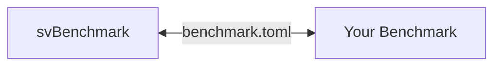
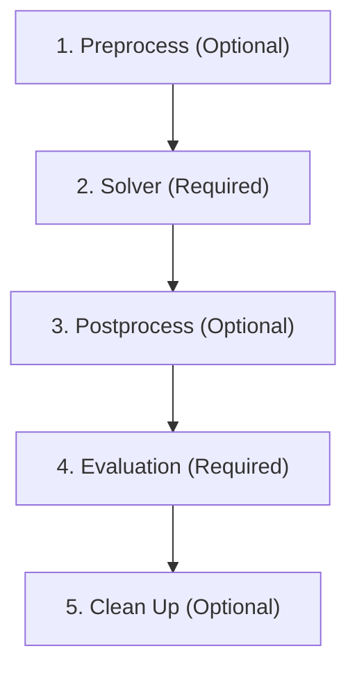

# Benchmarking

> [!CAUTION]
> This Readme and `svbenchmark` is currently a work in progress, and may change in the future.

Benchmarking is an important part of solver development. Here, we are specifically refering to three different types of benchmarks:

1. Verification - does the solver agree with the math that it is claiming to solve?
2. Validation - does the solver and the assumptions made accurately represent the reality of interest?
3. Performance - does the solver use an appropriate amount of resources?

Benchmarking serves as one component of testing the software, and specificaly tests the solver as a whole against reference solutions. This complements unit tests, integration tests, and system tests, that are testing the code itself, rather than the performance of the software.

## Adding a new Benchmark

You can add a new benchmark by making a new folder under the relevant domain in `/benchmark/cases/<Domain>/<Your Benchmark>`. This folder just needs to have a `benchmark.toml` file defined. [See below](#benchmark-structure)

## Running a Benchmark

The easiest way to run the benchmark is to use the `svbenchmark` Python package. To run the benchmark, use a Python script to set the execution environment (probably a local path if on your local computer) and run the `benchmark.toml`.

### svbenchmark

`svbenchmark` is the harness layer that pytest uses to run the TOML specifid Benchmark. This is also useful for debugging your benchmark before uploading so that it can run automatically.

## Benchmark Structure

Each benchmark *must* contain a `benchmark.toml`.

The `benchmark.toml` is the Benchmark Specification and it contains directions for how to run and evaluate the benchmark. It is formatted as a TOML file (Tom's Obvious Markup Language) which is a lightweight and readable markup format.

Specifically, the Benchmark Specification contains:

1. name (Required) - The general name of the benchmark
2. reference_source (Required) - The basis of the reference
3. preprocess (Optional) - Command that runs any preprocessing
4. solver (Required) - Solver input files and conditions
5. postprocess (Optional) - Command that runs any postprocessing
6. evaluation (Required) - Description of what is being evaluated and how to extract it (see below)
7. cleanup (Optional) - Command that runs any cleanup at the end

An optional but highly suggested `readme.md` is the long description of the benchmark. The format is decided by the writer of the benchmark, however it is recommended to contain at least the following two items:

## Benchmark Execution

A benchmark is evaluated from outside the benchmark (i.e., the execution environment is *not* specified by the benchmark). This is intentional as execution settings (e.g., how many cores, which solver build) are separate from the benchmark definition (i.e., the science)

## Evaluation Criteria

Evaluation criteria are what the Benchmark is being compared against. The general principle is, the benchmark determines what to evaluate, how to calculate that value, and what the reference is, while the execution environment performs and interprets the comparison. 

Each evaluation criteria is defined in the Benchmark Manifest, and *each* criteria is associated with a single run command that returns a *single* to stdout (e.g., `print()` for Python). stderr is also captured, but only logged and there is no expectation of the format. If the evaluation script should error, any non float value will be treated as an error so an error message will be treated as an error. Nevertheless, it is recommended that simply *nothing* is written to stdout upon error.

